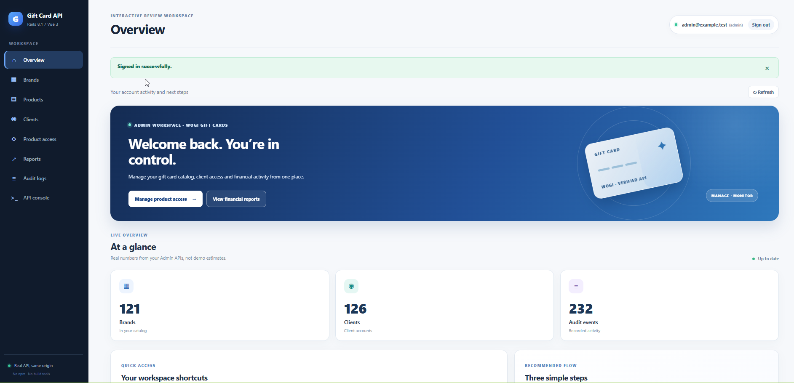
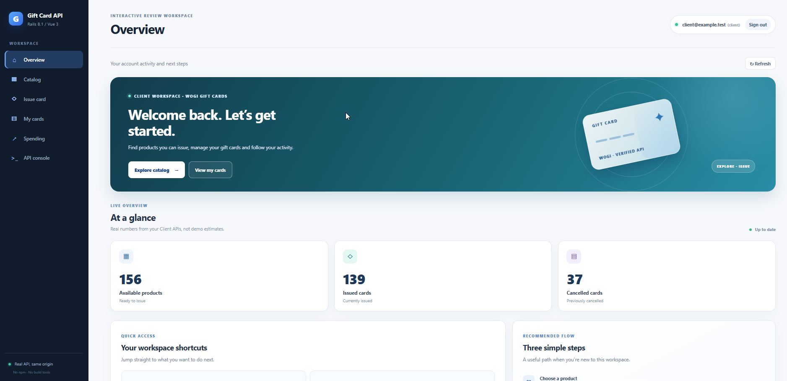

# WOGI Gift Card API

A role-based Gift Card REST API built with **Ruby 3.4.12**, **Rails 8.1 (API mode)**, **PostgreSQL**, and **RSpec**. An optional **Vue 3 browser review workspace** is served by the same Rails process without npm or a frontend build. The UI calls real JSON endpoints backed by PostgreSQL; no external gift card provider is needed.

**Scope:** Private assignment implementation for local review. Core API, Admin/Client workflows, and automated tests are implemented; this is not a production payment system.

## Browser workspace previews

The optional **Admin** and **Client** dashboards connect to the real Rails API. The screenshots below show synthetic development records; totals may change after demo activity.

| Admin overview | Client overview |
| --- | --- |
|  |  |

Explore the **[complete gallery of 14 screenshots](screenshots/README.md)** covering Brands, Products, Clients, access grants, reports, auditing, gift-card issuance and the API console.

## Quick start

### Requirements

- Ruby **3.4.12** (see [.ruby-version](.ruby-version)), Bundler, and PostgreSQL; **PostgreSQL 16** is used in CI.
- Authorized access to this private GitHub repository.
- For the optional UI only: a browser with internet access to the pinned Vue 3 CDN script.
- **Not required:** Node.js, npm, Vite, a notebook, Cloudflare Tunnel, or a third-party API key.

The default development/test connection uses a local PostgreSQL socket and the current OS database role. On Linux, if that role is missing, an administrator can create it with `sudo -u postgres createuser --createdb "$(whoami)"`. Alternatively, configure `DATABASE_URL` or your local PostgreSQL settings.

### Installation and startup

~~~bash
git clone https://github.com/dangkhoa2016/Rails-8-Gift-Card-API.git
cd Rails-8-Gift-Card-API

bundle install
bin/rails db:prepare

# Replace with distinct, strong, development-only passwords.
export DEMO_ADMIN_PASSWORD='REPLACE_WITH_A_STRONG_ADMIN_PASSWORD'
export DEMO_CLIENT_PASSWORD='REPLACE_WITH_A_DIFFERENT_STRONG_CLIENT_PASSWORD'
bin/rails db:seed

bin/rails server
~~~

Open **http://localhost:3000/demo** for the reviewer interface or **http://localhost:3000/up** for Rails health.

| Role | Login email | Password |
|---|---|---|
| Admin | `admin@example.test` | Your `DEMO_ADMIN_PASSWORD` |
| Client | `client@example.test` | Your `DEMO_CLIENT_PASSWORD` |

### Development seed data

On a **fresh development database**, `bin/rails db:seed` creates the following synthetic review dataset:

| Record type | Initial count | Composition |
|---|---:|---|
| Brands | **121** | 1 primary gift-card Brand + 120 additional Brands |
| Products | **256** | 1 primary Gift Card + 135 primary-Brand catalog Products + 120 secondary-Brand Products |
| Clients | **126** | 1 reviewer Client + 125 synthetic Clients (plus 1 Admin account) |
| Product access grants | **662** | Authorized Product assignments for Clients |
| Cards | **184** | 160 primary Client Cards + 24 additional reporting Cards |
| Audit events | **223** | Synthetic issue and cancellation activity |

Brands use readable fictional names with a **deterministic, random-looking four-digit suffix**, such as `Aurora Market 9128` and `Bluebird Market 2449`. Catalog Products use descriptive labels such as `Everyday USD Gift Card 8266` rather than numbered internal fixture names. The four-digit suffixes remain stable between seed runs; they are not regenerated on every execution.

The seed is **development-only and repeatable**. It reuses existing fixtures and idempotency keys instead of issuing duplicate Cards, and supports renaming legacy synthetic Brand/Product labels in place while preserving their IDs, Card history, and financial snapshots. Existing Admin edits and additional activity may make the actual counts differ from the fresh-database baseline. Passwords and PINs are never printed. Use only in a disposable development database.

[.env.example](.env.example) documents optional JWT, encryption, demo credentials, and diagnostic settings. It is **not automatically loaded**; export environment variables yourself. Development/test encryption can derive key material from Rails' `secret_key_base`. Never commit credentials or enable `WOGI_SHOW_EXCEPTION_DETAILS` on an internet-exposed demo.

## Functional overview

### Admin

Manage Brands and Products, create/update Clients, grant/revoke Product access, inspect financial reports by Brand or Client, and filter Audit logs. Admin directories and Brand Product listings use server-side pagination; related entities open accessible read-only modals. The Admin API Console also supports issuing, replaying, and cancelling a Card **for a selected Client**, without disclosing its PIN.

### Client

Explore an authorized Catalog using name, Brand, and currency filters. The optional storefront offers gift-card visuals, sorting, and **12/24/48-card UI pages** (the Catalog API itself is unpaginated). Selecting a Product opens a separate **Issue card** review screen. Search and paginate **My cards**, filter by status or PIN availability, inspect Card details, cancel an issued Card, and view spending by currency or Brand.

PIN values are intentionally absent from Card lists/details, audits, and reports. A permitted Client can reveal a newly issued PIN briefly or use a separate **password-confirmed** reveal endpoint for an owned Card.

### Suggested acceptance walkthrough

1. Sign in as **Admin**; review Brands, Clients, Product access, reports, and audit activity.
2. Sign out and sign in as **Client**. Open Catalog, choose an eligible Product, and continue to **Issue card**.
3. Issue with a new `Idempotency-Key`: expect **201 Created**. Repeat the **identical** request with the same key: expect **200 OK** and the same Card ID. Reuse the key with changed data: expect **409 Conflict**.
4. Inspect or cancel an owned Card and check Spending. Return as Admin to compare reports and audit events.

The role-aware **API Console** exposes editable request templates and JSON responses. Selecting a template does not execute it. Browsing and reporting are read-only; issuance and cancellation change actual development records. Sidebar navigation scrolls to the page top.

## API reference

Every business endpoint is under `/api/v1`. Except for login, requests use `Authorization: Bearer <jwt>`. JWTs expire after **one hour**, and the server checks account status and role.

| Scope | Route | Methods / purpose |
|---|---|---|
| Authentication | `/api/v1/auth/login`, `/api/v1/auth/logout` | POST; sign in, auditable sign-out |
| Admin Brands | `/api/v1/admin/brands`, `/api/v1/admin/brands/:brand_id/products` | List, create, inspect, update |
| Admin Products | `/api/v1/admin/products/:id` | GET, PATCH, DELETE (soft-delete) |
| Admin Clients | `/api/v1/admin/clients`, `/api/v1/admin/clients/:id` | List, create, inspect, update |
| Admin access | `/api/v1/admin/clients/:client_id/product_accesses` | GET, POST; DELETE via `/:product_id` |
| Admin Card issuance | `/api/v1/admin/clients/:client_id/cards` | POST with mandatory idempotency key |
| Admin Card cancellation | `/api/v1/admin/clients/:client_id/cards/:id/cancel` | POST for selected Client's Card |
| Admin reporting | `/api/v1/admin/reports/by_brand`, `/api/v1/admin/reports/by_client`, `/api/v1/admin/reports/cards` | GET; reports and Card drill-down |
| Audit | `/api/v1/admin/audit_logs` | GET; filters and pagination |
| Client Catalog | `/api/v1/client/catalog` | GET; optional `q`, `brand_id`, `currency` |
| Client Cards | `/api/v1/client/cards`, `/api/v1/client/cards/:id` | GET, POST; own Cards, filters, sorting, pagination |
| Client cancellation | `/api/v1/client/cards/:id/cancel` | POST |
| Client PIN reveal | `/api/v1/client/cards/:id/reveal_pin` | POST; password confirmation |
| Client reporting | `/api/v1/client/reports/spending`, `/api/v1/client/reports/cards` | GET; own activity and drill-down |

For complete HTTP examples and error responses, see [API Examples](docs/API_EXAMPLES.md). The API returns JSON `data`, `error`, and optional `meta`; it does not claim full JSON:API specification compliance.

## Security and correctness

- **Authorization:** wrong-role requests are refused; Client ownership is enforced in database queries. Inactive accounts and invalid tokens cannot access protected endpoints.
- **Idempotency/concurrency:** a unique PostgreSQL `(client_id, idempotency_key)` constraint, transaction-scoped advisory locking, and globally unique activation numbers prevent duplicate issuance.
- **Financial records:** issuance snapshots face value, currency, payout rate, and payout amount; calculations use `BigDecimal` and two-decimal rounding. Reports separate currencies and use UTC event-time windows, without implicit foreign exchange conversion.
- **Cancellation:** row-locked, one-way `issued → cancelled`; original Card values remain available even after Product deactivation or access revocation.
- **Secrets and PINs:** bcrypt passwords, Active Record Encryption at rest, parameter filtering, non-cacheable and rate-limited PIN reveal, and allowlisted audit snapshots.
- **Errors and logout:** structured error responses; bounded diagnostics are opt-in and development-only. Logout records an audit and discards the browser token, but **does not revoke the JWT server-side**.

## Tests and CI

~~~bash
RAILS_ENV=test bin/rails db:prepare
bundle exec rspec
bin/rubocop
bin/brakeman --no-pager
bin/bundler-audit check --update
bin/rails zeitwerk:check
~~~

[GitHub Actions](.github/workflows/ci.yml) runs RSpec against PostgreSQL 16, Ruby style checks, Brakeman, and dependency auditing on `main`. The optional frontend is covered by request/asset regressions and browser navigation checks.

## More documentation

- [Architecture](docs/ARCHITECTURE.md) — domain models, services, transactions, and request flow.
- [Design decisions](docs/DESIGN_DECISIONS.md) — documented trade-offs and scope.
- [API examples](docs/API_EXAMPLES.md) — authenticated requests and response semantics.
- [Demo UI guide](docs/DEMO_UI.md) — full reviewer workflows, filters, pagination, and accessibility.

## Limitations

This is an **API assignment and local review system**, not a production-ready payment or external gift-card integration. Server-side JWT revocation, general production rate limiting and hardening, live FX conversion, and current outstanding/as-of payout reporting are outside the implemented scope. The optional UI needs the Vue CDN; the API works independently. No hosted demo, notebook, or tunnel is required.
