# WOGI Gift Card API — Browser workspace screenshots

The screenshots below show the optional **Vue 3 browser workspace** calling the real **Rails 8 / PostgreSQL API**. They were captured from the synthetic development demo, not a mock API or a payment provider.

Counts and records shown in a screenshot are point-in-time examples. They may differ from the fresh seed baseline after an Admin or Client performs additional operations.

Click any image to open its full-size PNG.

## Admin workspace

| Overview | Brands |
| --- | --- |
|  | [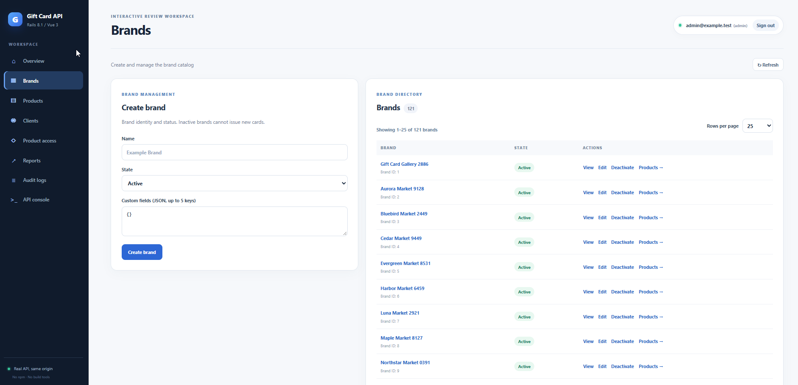](admin/brands.png) |

| Products | Clients |
| --- | --- |
| [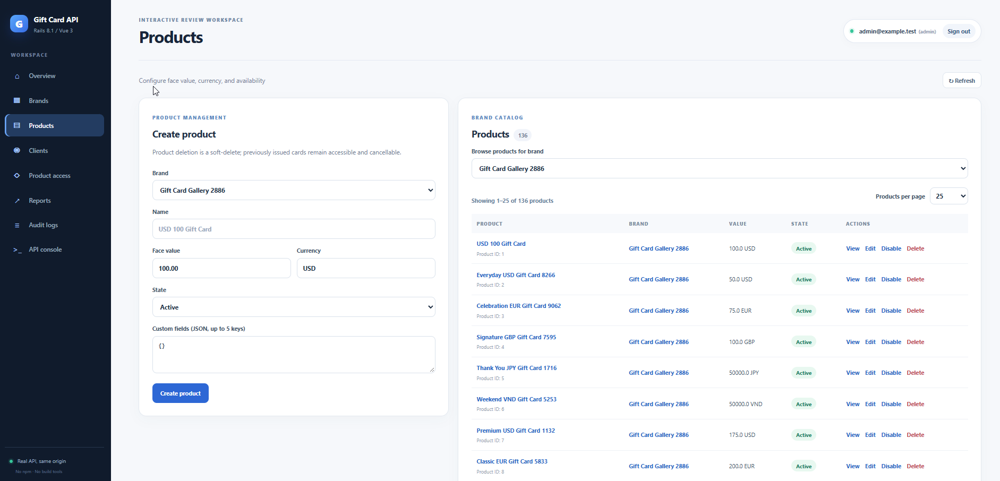](admin/products.png) | [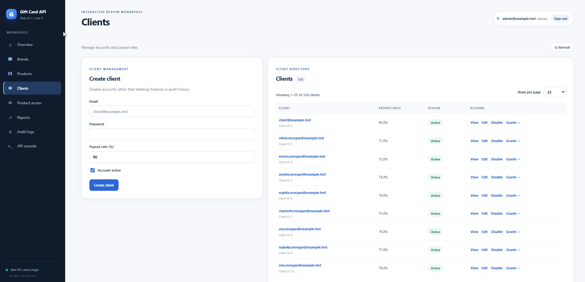](admin/clients.png) |

| Product access | Financial reports |
| --- | --- |
| [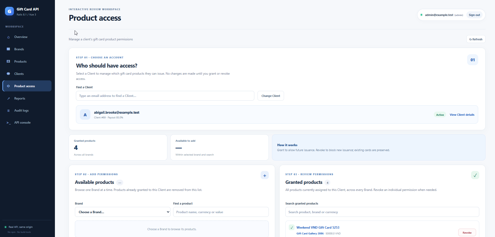](admin/product-access.png) | [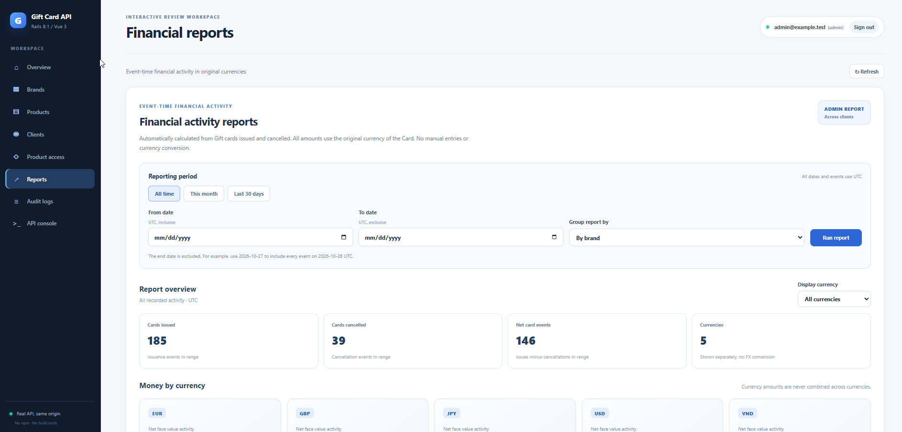](admin/financial-reports.png) |

| Audit logs | API console |
| --- | --- |
| [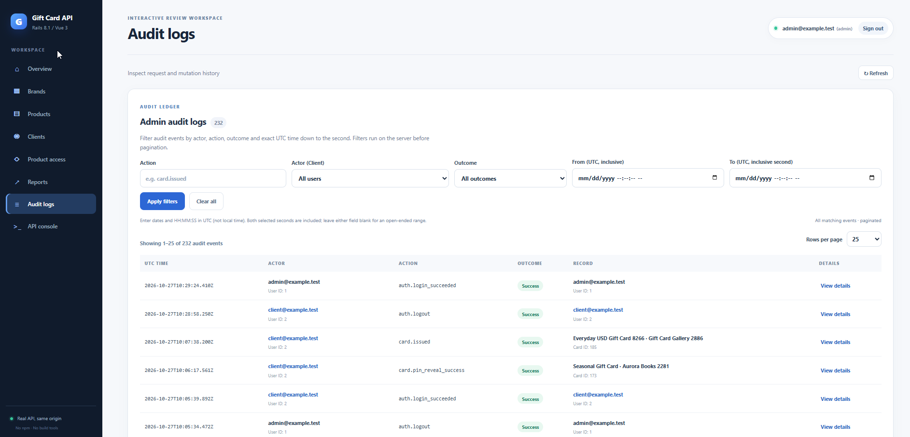](admin/audit-logs.png) | [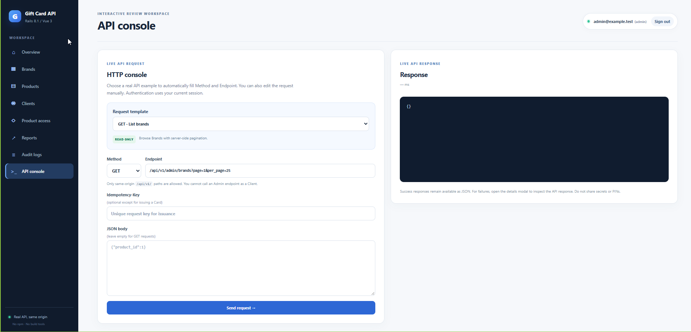](admin/api-console.png) |

## Client workspace

| Overview | Catalog |
| --- | --- |
|  | [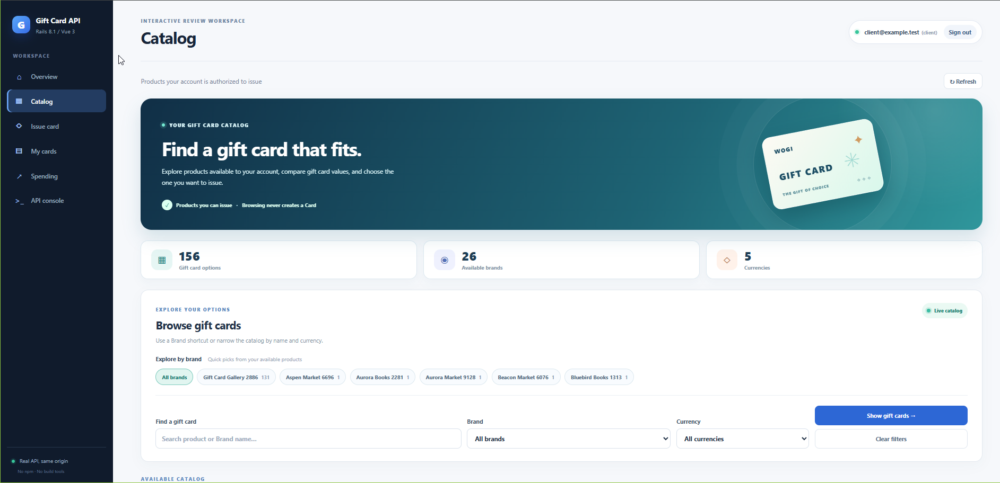](client/catalog.png) |

| Issue gift card | My cards |
| --- | --- |
| [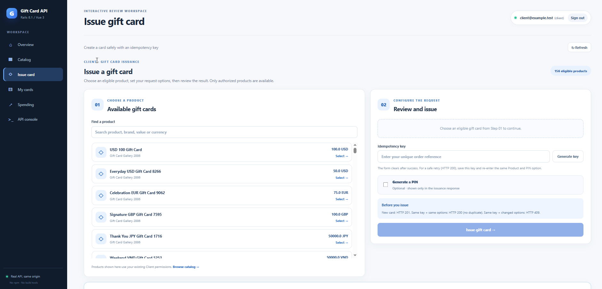](client/issue-gift-card.png) | [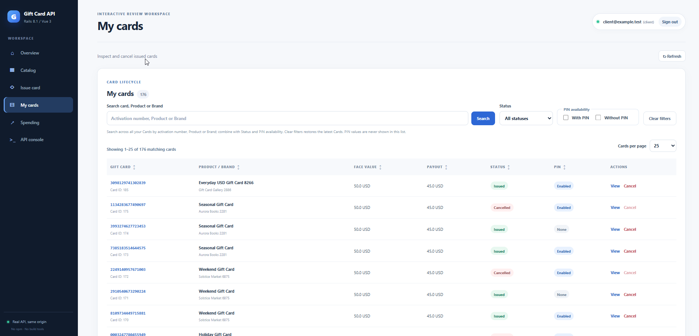](client/my-cards.png) |

| Spending reports | API console |
| --- | --- |
| [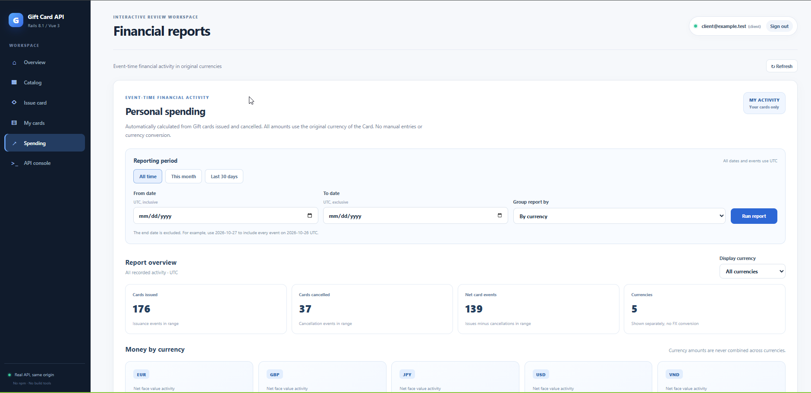](client/spending-reports.png) | [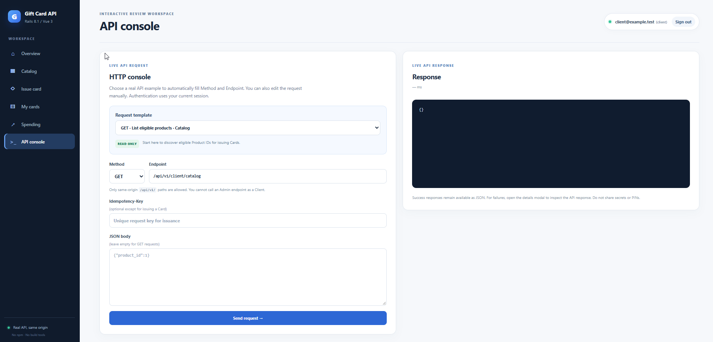](client/api-console.png) |

All 14 PNG files retain their original bytes. [SHA-256 checksums](SHA256SUMS.txt) are provided for integrity checking.
